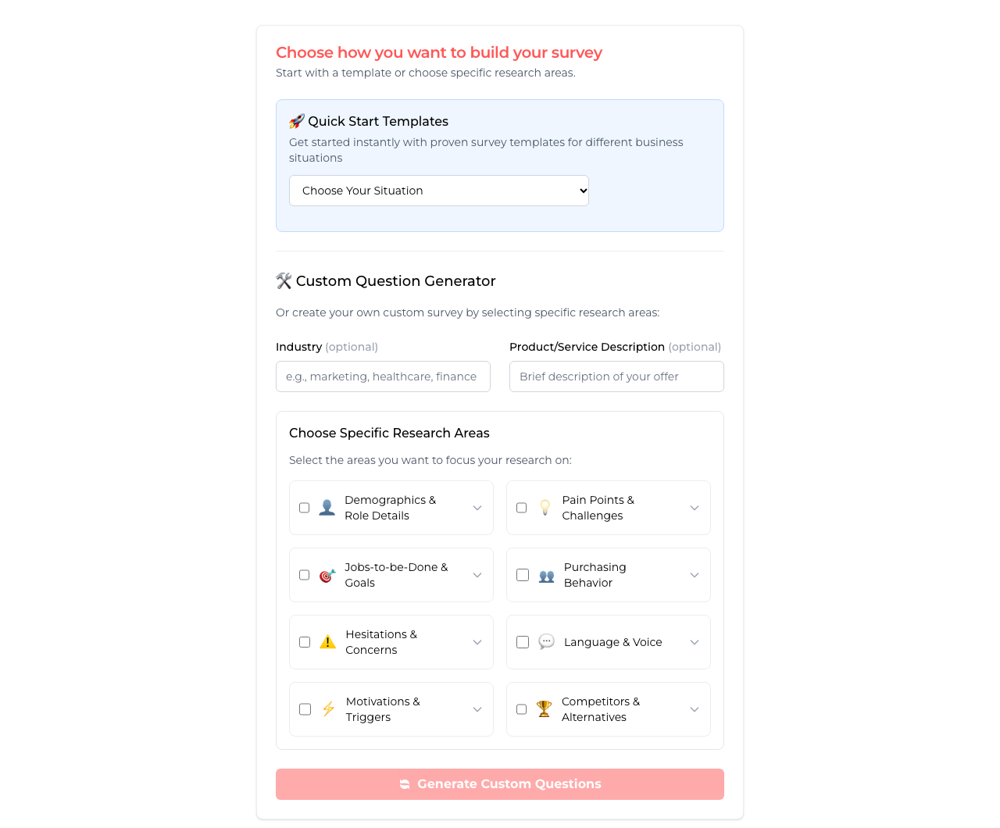

# Customer Research Survey Generator

Create a customer research survey in minutes, then learn what your customers think before, during and after they buy.

This free web tool helps you build a short survey to uncover pain points, buying triggers, objections and the exact words customers use. Choose a template or pick the research areas you care about, keep the questions you want, and copy the survey into Google Forms, Typeform or an email.

**[Try the survey generator](https://www.8bitcontent.com/customer-research-survey-generator)**



## How it works

1. **Start with a template or research areas:** choose the situation closest to yours, or select the areas you want to learn about.
2. **Add context (optional):** enter your industry and a short description of what you sell.
3. **Choose your questions:** keep the ones you want. Refresh for new options, or use **Fill Gaps** to replace template questions you removed.
4. **Use your survey:** copy it, or download it as a text file.

## Templates

| Template | Use it to |
|---|---|
| **New Business** | Survey potential customers when you don't have customers yet |
| **Existing Product** | Learn why customers chose you and how to attract more like them |
| **Competitive Research** | Understand the alternatives and find positioning opportunities |
| **Content Strategy** | Capture the language customers use, for better copy and content |
| **Customer Satisfaction & Experience** | Measure satisfaction and find what to improve |
| **Sales Process Optimization** | Understand the buying journey and improve your sales process |
| **Feature Development & Product** | Guide your roadmap with feedback on feature use and gaps |

## Research areas

- Demographics and role details
- Pain points and challenges
- Jobs-to-be-done and goals
- Purchasing behavior
- Hesitations and concerns
- Language and voice
- Motivations and triggers
- Competitors and alternatives

The questions draw on Jobs-to-Be-Done and voice-of-customer research.

## Privacy

There's no account, and the tool doesn't use AI. Questions come from a built-in question bank, and the app's code doesn't save or send what you type. Reloading the page clears it.

The tool doesn't collect survey responses, either. You send the survey with your own form or email tool, so the responses stay there.

## Run it locally

You'll need Node.js 20.9 or newer.

```bash
git clone https://github.com/8bitcontent/customer-survey-tool.git
cd customer-survey-tool
npm install
npm run dev
```

Then open [http://localhost:3000](http://localhost:3000).

## Project layout

It's a [Next.js](https://nextjs.org) app written in TypeScript and styled with Tailwind CSS. Most of it is in one file, `app/page.tsx`:

| To change | Look for |
|---|---|
| **Question bank** | `discoveryQuestions` |
| **Templates** | `surveyTemplates` |
| **Text used when you copy or download** | `copyToClipboard` and `exportSurvey` |

The page sends its height to the parent page with `postMessage` (type `survey-frame-height`), so an iframe embed can resize to fit.

Made by [8-Bit Content](https://www.8bitcontent.com/).
